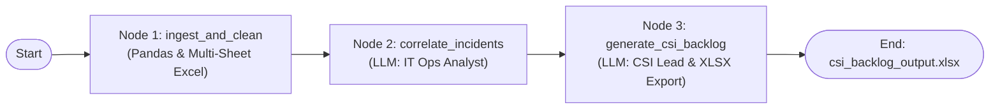

# IT Operations Continual Service Improvement (CSI) Agent POC

A Python Proof of Concept (POC) demonstrating how to leverage **LangGraph**, **Pandas**, and **OpenAI (gpt-4o)** to break down operational silos between manually maintained multi-sheet batch monitoring Excel trackers and ITSM incident logs. The agent ingests telemetry, correlates failures across applications and batch processes, and generates an automated, data-driven **Problem Management / Continual Service Improvement (CSI) Backlog in Excel (.xlsx) format**.

---

## Output Delivered: Excel (`.xlsx`) Only

When the pipeline finishes, the final output is saved directly as a styled Excel workbook at:
```
/Users/amankumar/Desktop/New-POC/csi_backlog_output.xlsx
```

### Workbook Sheets:
1. **`CSI_Backlog`**:
   - Standardized Problem Management Backlog.
   - **Columns:** `Priority` | `Systemic Issue Theme` | `Impacted Jobs/CIs` | `Linked Tickets & Evidence` | `Root Cause Pattern` | `Recommended CSI Action`
   - Formatted with custom column widths, text wrapping, borders, header styling, and priority status highlights (P1, P2, P3).
2. **`RCA_Correlated_Findings`**:
   - Full technical IT Operations RCA report detailing upstream-to-downstream failure chains and ticket correlations.

---

## Inputs (Native Excel `.xlsx`)

The system reads native **Excel (`.xlsx`) files** from `data/`:

1. **`data/batch_logs.xlsx`** (Multi-sheet batch tracker):
   Each sheet represents an application run or daily operations tracker (matching the tabs at the bottom of the manual Excel sheet):
   - `App_Alpha_Day1`, `App_Beta_Day1`, `App_Gamma_Day1`
   - `App_Alpha_Day2`, `App_Beta_Day2`, `App_Gamma_Day2`, `App_Delta_Day2`
   - **Hierarchy:** `Batch_Cycle` $\to$ `App_Name` $\to$ `Process_Name`
   - **Columns:** `Sheet_Tab` | `Batch_Cycle` | `App_Name` | `Process_Name` | `StartTime` | `EndTime` | `Duration` | `Status` | `Comments` | `Cancelled`

2. **`data/incident_logs.xlsx`** (ITSM Incident records):
   - **Sheet:** `Incidents`
   - **Columns:** `Number` | `Configuration_Item` | `Short_Description` | `Work_Notes`

---

## How to Run the Code

```bash
# Direct run using project virtual environment
.venv/bin/python main.py
```

Or activate the environment:
```bash
source .venv/bin/activate
python main.py
```

---

## LangGraph Workflow Architecture


